<div align="center">


<a href="https://github.com/marc0odev"></a>

<br/>

<a href="https://github.com/marc0odev?tab=followers"></a>

<a href="https://www.fiap.com.br/"></a>


</div>

<br/>

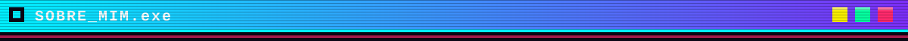

<br/>

<table>
<tr>
<td width="55%" valign="top">

```text
╔══════════════ FICHA DO PERSONAGEM ══════════════╗
  NOME ......... Marco Fonseca  (@marc0odev)
  CLASSE ....... Desenvolvedor Back-End
  NIVEL ........ Ciencia da Computacao @ FIAP / 2028
  BASE ......... Sao Paulo, Brasil
  ARMAS ........ Java • Spring Boot • SQL • Git
  MAGIAS ....... Python • TypeScript • Dart • C
  MISSAO ....... Transformar café em APIs
╚═════════════════════════════════════════════════╝
```

</td>
<td width="45%" valign="top">

**👾 Quem sou eu**

Sou estudante de Ciência da Computação na **FIAP** e foco em **desenvolvimento Back-End** com Java, Spring Boot, SQL e Git. Meu objetivo é construir APIs e sistemas sólidos, e crescer como engenheiro de software a cada projeto.

Fora do Back-End, já coloquei a mão em **apps mobile** (Flutter e React Native), **IoT com ESP32**, **visão computacional** e **análise de dados com Python** nos projetos da faculdade.

</td>
</tr>
</table>

<br/>

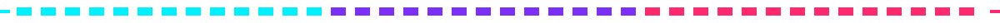

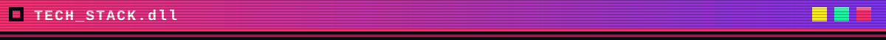

<br/>

<div align="center">

**⚔️ Back-End & Dados**


**📱 Mobile & Front-End**


**🔌 Baixo Nível & Cloud**


</div>

<br/>


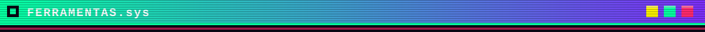

<br/>

<div align="center">


</div>

<br/>


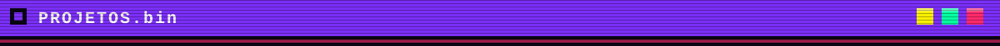

<br/>

<table>
<tr>
<td width="50%" valign="top">

<sub><b>📱 MOBILE • FLUTTER + FIREBASE</b></sub>

<a href="https://github.com/enzinh16/aBolha"></a>

<sub>Rede social de comunidades de nicho, em desenvolvimento com a equipe da FIAP.</sub>

</td>
<td width="50%" valign="top">

<sub><b>🛰️ MOBILE • REACT NATIVE + EXPO</b></sub>

<a href="https://github.com/marc0odev/FIAP-CPAD_SPRINT4"></a>

<sub>App e dashboard de monitoramento de vegetação em rodovias, desafio Motiva da FIAP.</sub>

</td>
</tr>
<tr>
<td width="50%" valign="top">

<sub><b>☕ JAVA • EQUIPE 11</b></sub>

<a href="https://github.com/marc0odev/cp5-bughunt-equipe11"></a>

<sub>Projeto Bug Hunt em Java, desenvolvido em equipe na FIAP.</sub>

</td>
<td width="50%" valign="top">

<sub><b>🩺 TYPESCRIPT • MOBILE</b></sub>

<a href="https://github.com/marc0odev/sistema-consultas-mobile"></a>

<sub>Sistema de consultas mobile, terceiro projeto da matéria CPAD.</sub>

</td>
</tr>
<tr>
<td width="50%" valign="top">

<sub><b>🐍 PYTHON</b></sub>

<a href="https://github.com/marc0odev/PCP-GS2"></a>

<sub>Global Solution em Python, desenvolvida na FIAP.</sub>

</td>
<td width="50%" valign="top">

<sub><b>⚙️ C</b></sub>

<a href="https://github.com/marc0odev/DSA-GS2"></a>

<sub>Global Solution da FIAP, escrita em C.</sub>

</td>
</tr>
</table>

<div align="center">

<a href="https://github.com/marc0odev?tab=repositories"></a>

</div>

<br/>


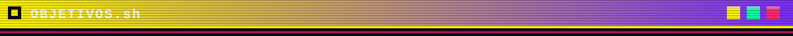

<br/>

<div align="center">


</div>

<br/>


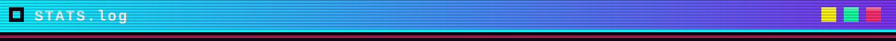

<br/>

<div align="center">

<table>
<tr>
<td align="center"></td>
<td align="center"></td>
</tr>
</table>


<br/><br/>


</div>

<br/>


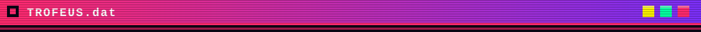

<br/>

<div align="center">


</div>

<br/>


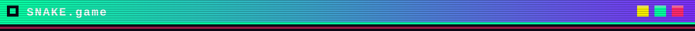

<br/>

<div align="center">

<picture>
  <source media="(prefers-color-scheme: dark)" srcset="https://raw.githubusercontent.com/marc0odev/marc0odev/output/github-snake-dark.svg"/>
  <source media="(prefers-color-scheme: light)" srcset="https://raw.githubusercontent.com/marc0odev/marc0odev/output/github-snake.svg"/>
  
</picture>

</div>

<br/>


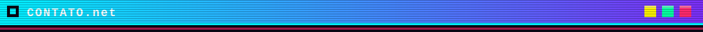

<br/>

<div align="center">

<a href="https://github.com/marc0odev"></a>
<a href="https://www.linkedin.com/in/marco-antonio-ferreira-fonseca-105b16346/"></a>
<a href="marcoffonseca0804@gmail.com"></a>

<br/><br/>

<sub>Aberto a conversas sobre Back-End, estágio e projetos em equipe.</sub>

</div>

<br/>

<div align="center">


</div>
